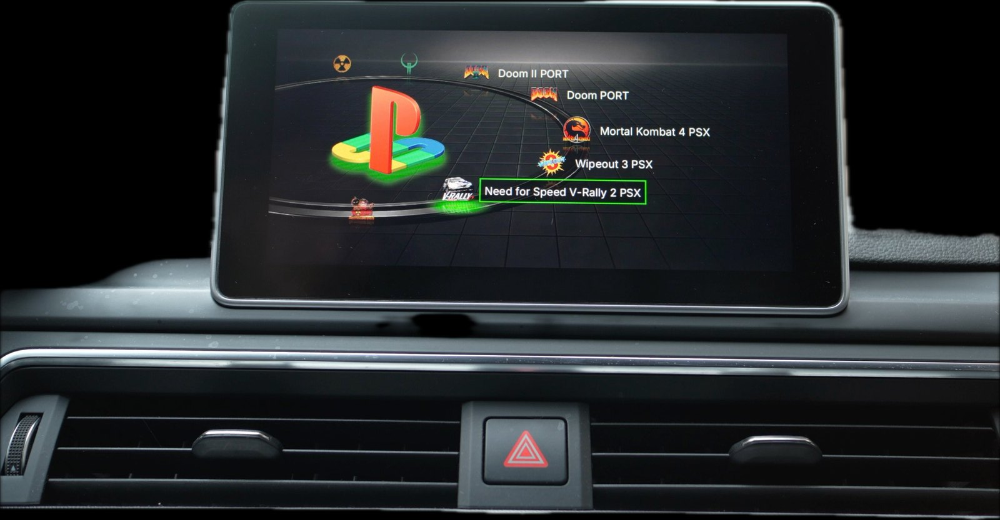

# Audi MIB gaming – minimal kit

A PS1 and SNES game launcher for the **Audi MIB2 High** head unit. Games run from the SD card, are played with a wired DualShock 3, and only with the car parked.

*The launcher on the author's car, running the full personal setup. The kit in this repository uses a plain background and lists only the PS1 and SNES games you add; the native ports seen in the picture are not part of it.*

## Not included – you must supply these yourself

| What | Where it goes | Needed for |
|---|---|---|
| **PlayStation BIOS** `scph1001.bin` | `game/bios/` | PS1 games. Without it PS1 games may not start or may not run correctly. |
| **Your PS1 games** | `game/psx/` | Anything to appear in the list as PSX. |
| **Your SNES games** | `game/snes/` | Anything to appear in the list as SNES. SNES needs no BIOS. |

The BIOS and the games are copyrighted by their owners. This repository does not contain them and never will; use files you are entitled to use.

---

## Read this first

**This can brick your MMI.** The installer replaces a file inside the head unit. If something goes wrong (power loss during the copy, a firmware it was not made for, a mistake on your side), the unit may no longer start its interface. A bricked MIB2 is expensive to repair or replace.

- **You do this entirely at your own risk.** There is no warranty of any kind. I am not responsible for damage to your head unit, your car, or anything else.
- **No support.** I will not help with installation, recovery, or other firmware versions.
- **Tested on exactly one car:** Audi A5 B9 (8W) 2018, MIB2 High (MHI2Q), firmware **P5092 / MU1329**, 1024×480 screen. That car also has an "Android Auto navigation in the cluster" patch installed. Nothing here has been run on any other unit or firmware.
- **This trimmed kit is a new build.** It is derived from the setup that runs on the car above, but the kit variant itself (a bridge that no longer needs that patch) has **not been run on a car yet**. Treat it as untested.
- **M.I.B. must already be installed.** You need a working Green Menu (GEM) and the [M.I.B. – More Incredible Bash](https://github.com/Mr-MIBonk/M.I.B._More-Incredible-Bash) tool on the unit. This kit does not install them and does not explain how.
- If you do not know how to recover a MIB2 unit that no longer boots its interface, **do not install this.**

Only use it with the car parked. It is a toy for a parked car, not something to use while driving.

---

## What it does

- Adds a game list that opens from the MMI: **car in P, standing still, brake pressed, hold MENU for 1.5 s.**
- Lists PS1 games from `game/psx` and SNES games from `game/snes`.
- Safety is built in and cannot be switched off from a menu:
  - the launcher opens only in P with the car standing still;
  - a running game closes immediately if the car leaves P or starts moving;
  - selecting reverse closes the game and the camera takes over.
- Sound goes through the car speakers; the car's volume knob works.
- Nothing is sent to the car. The instrument cluster is not touched.

## What gets changed on the unit

One file: `/mnt/app/eso/hmi/lsd/jars/xTcpKeyPanel.jar` is replaced with a version that also contains the "bridge" classes.

This repository does not contain that file, or any other file from the Audi firmware. The installer **builds it on the unit**, from the unit's own original file plus the project's classes (`game/punte/bridge_classes.zip`), using a small tool (`game/punte/mkbridge`, source in `source/mkbridge`).

The installer:

1. checks that the file on the unit is **byte-identical** to the known original (size and checksum); if not, it stops and changes nothing;
2. builds the new file in `/tmp` and verifies it entry by entry against its sources;
3. saves the original on the unit (`/mnt/app/root/game_backup`) and on the card (`game/backup`), and verifies both copies;
4. copies the new file to the unit, verifies the copy, and puts the original back if the check fails.

Everything else (launcher, emulators, games, saves) stays on the SD card.

## Requirements

- Audi MIB2 High (MHI2Q) with firmware P5092 / MU1329. On other firmware the installer will most likely stop on its own.
- Green Menu enabled and the M.I.B. tool installed on the unit.
- The M.I.B. SD card, in slot **SD1**. It must stay in the slot to use the games.
- A DualShock 3 (PS3) controller on a USB cable.
- Your own PS1 BIOS (`scph1001.bin`) and your own games – **not included**, see the table at the top.

## Setup

1. Copy `mod/` and `game/` from this repository to the root of your M.I.B. SD card.
   `mod/command.sh` replaces any `command.sh` already on the card.
2. Add your files:

   | Folder | What goes in | Formats |
   |---|---|---|
   | `game/psx` | PS1 games | `.chd`, `.cue` + `.bin`, `.pbp`, `.iso` |
   | `game/snes` | SNES games | `.sfc`, `.smc` |
   | `game/bios` | PS1 BIOS | `scph1001.bin` |

3. Icons are optional: a `.png` with the same name as the game file, next to it
   (`Aladdin.cue` + `Aladdin.bin` + `Aladdin.png`, or `Aladdin.sfc` + `Aladdin.png`). 256×256 works well.
   A game without its own image gets a generic one: a disc for PS1, a cartridge for SNES.
4. Optional order: `game/psx/ordine.txt`, one game name per line, without extension.

## Install (once)

1. Card in SD1, ignition on, car in P. Do not switch the ignition off while the script runs.
2. Green Menu → M.I.B. → run `command.sh`.
3. Read the message on screen. The same text is saved on the card in `game/install_report.txt`.

   | Message | Meaning |
   |---|---|
   | `OK: bridge installed` | Reboot the unit and leave the card in. |
   | `OK: already installed` | Nothing to do. |
   | `STOP: ... is not the known original` | Different firmware, or the file was modified by something else. Nothing was changed. This kit cannot be used on that unit. |
   | `STOP: another bridge version is installed ...` | An older bridge is on the unit and its backup of the original is missing. Nothing was changed. |
   | `ERROR: ...` | Read the text; in every error case the installer leaves or restores the original file. |

## Using it

| Where | Action |
|---|---|
| Open the launcher | Car in P, standing still, brake pressed, hold **MENU** 1.5 s |
| In the list | D-pad up/down or left stick = choose, **X** = start |
| In a game | **Start + Select** held = back to the list |
| | **PS** held 1.5 s = close and return to the MMI |
| Safety net | **BACK** held 5 s (or PS held 5 s) = force-close everything |
| Volume | The car's volume knob |

PS1 games are shown with `PSX` after the name, SNES games with `SNES`.

## Known limits

- While a game runs, the MMI buttons are not blocked. Pressing them may also act on the MMI menu underneath. Use the controller.
- Sound uses the unit's Android Auto media audio channel. On a unit where that channel is not available, games may run silent. The channel number can be changed by writing it in a text file `game/conexiune.txt`.
- Performance depends on the SD card. A slow card causes short pauses while a game loads data.

## Uninstall

1. Create an empty file `game/UNINSTALL_BRIDGE` on the card.
2. Green Menu → M.I.B. → run `command.sh` again. It restores the original file from the backup.
3. Delete `UNINSTALL_BRIDGE` and reboot the unit.

Two more switches, both read by the bridge when the unit starts:

- `game/RESTORE_ORIG` (empty file): the bridge restores the original file by itself; reboot once more afterwards. Meant for the case where the Green Menu is not reachable.
- `game/bridge_off` (empty file): the bridge stays installed but does nothing.

Keep the `game/backup` folder. It holds your unit's original file.

## If something goes wrong

- **The launcher does not open:** look at `game/logs/bridge_log.txt`. A line with `MENU apasat ... refuzat` means the conditions were not met (not in P, not standing still, or brake not pressed).
- **Black or frozen screen:** hold BACK for 5 s.
- **A game does not start:** read `game/logs/psx_log.txt` or `game/logs/snes_log.txt`.
- **The interface no longer starts after installing:** this is the brick case from the warning above. Recovery needs access to the unit outside the Green Menu and is not covered here.

## What is in the repository

| Path | What it is |
|---|---|
| `mod/command.sh` | Installer / uninstaller, run from the Green Menu |
| `game/lansator.sh` | Launcher script, started by the bridge |
| `game/punte/` | `bridge_classes.zip` (the bridge classes) and `mkbridge` (builds the unit's file from them) |
| `game/sys/` | Launcher and emulator programs, controller reader, font, background, generic icons |
| `game/psx`, `game/snes`, `game/bios` | Empty; your games and BIOS go here |
| `source/` | Source code of the launcher, of `mkbridge`, and what is needed to rebuild the emulator cores |
| `licenses/`, `LICENSE` | Licence texts and which licence applies to what |

Log messages, code comments and some file names are in Romanian.

## Licences and third-party components

See `LICENSE` for the full picture. In short:

- `game/sys/psxfe` contains **PCSX ReARMed** and is distributed under the **GNU GPL v2**. Its complete source is the launcher in `source/launcher` plus the upstream core at the commit and with the patch given in `source/cores`.
- `game/sys/snesfe` contains **Snes9x 2010** and is distributed under the **Snes9x licence: non-commercial use only**. Source: same launcher, upstream commit and patch in `source/cores`.
- **stb_image / stb_truetype** by Sean Barrett (public domain / MIT) and **libretro.h** (MIT) are part of the launcher source.
- `game/sys/font.otf` is the **Inter** typeface, SIL Open Font License 1.1.
- The rest of the project is under the MIT licence.

Because of the Snes9x licence, **this kit may not be sold or used commercially.**

No games, no console BIOS and no Audi firmware files are included.

This project is not affiliated with, endorsed by, or supported by Audi AG, Volkswagen AG, Sony, or Nintendo. All trademarks belong to their owners.
